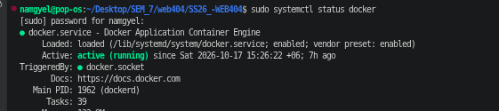
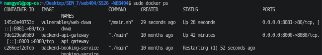
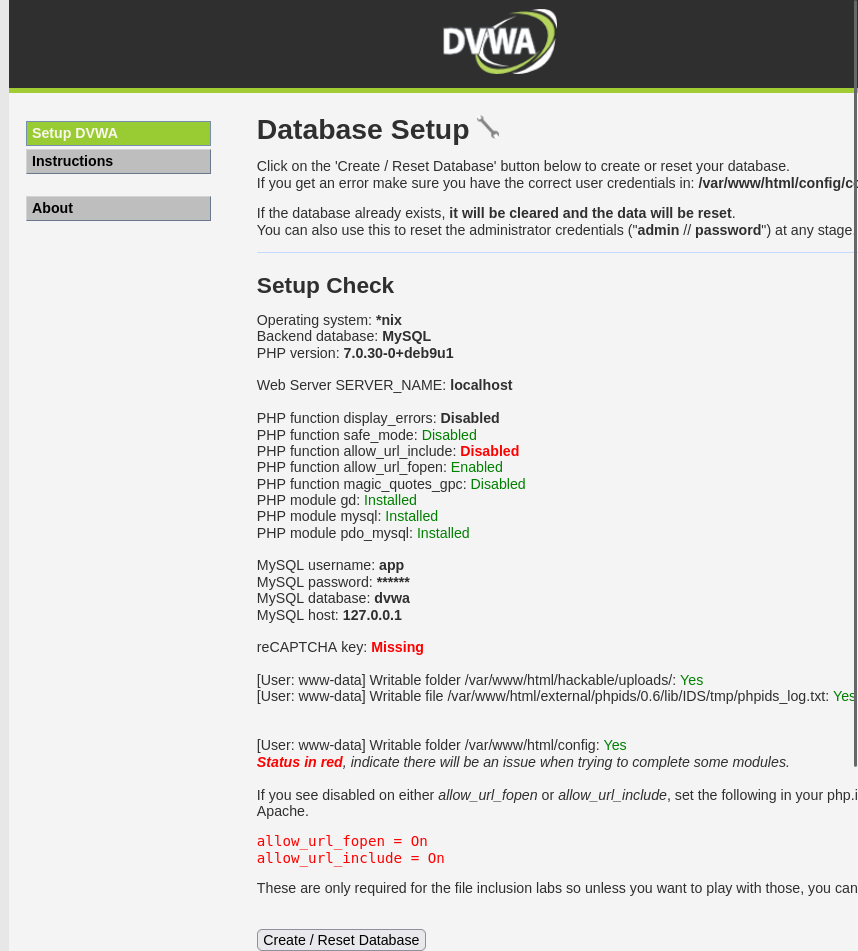
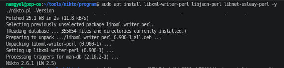
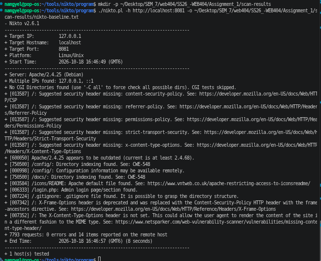
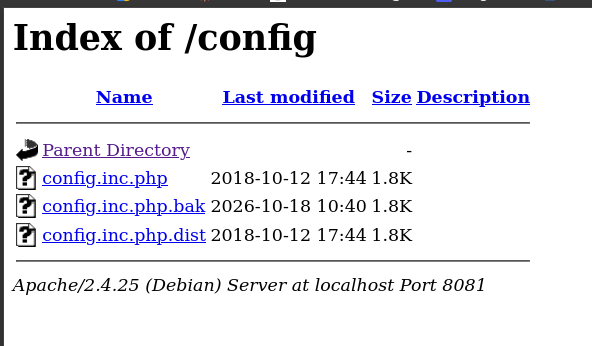
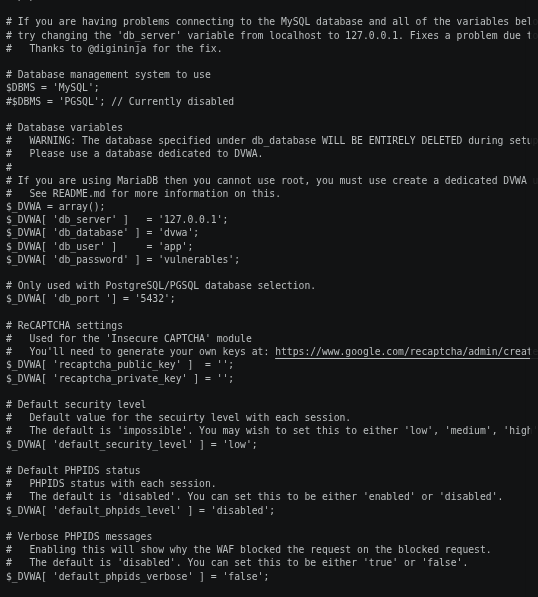
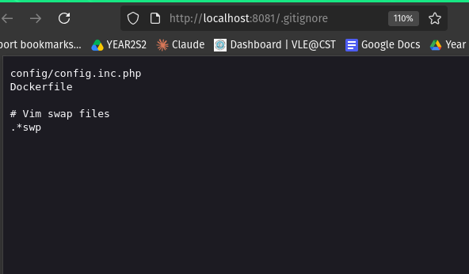
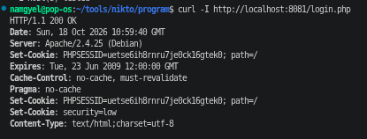

# Assignment 1: Vulnerability Assessment of DVWA Using Nikto

## Table of Contents

1. [Introduction](#1-introduction)
2. [Lab Environment](#2-lab-environment)
3. [Methodology](#3-methodology)
4. [Scan Results Overview](#4-scan-results-overview)
5. [Findings and Analysis](#5-findings-and-analysis)
6. [Attack Chain](#6-attack-chain)
7. [Manual Verification](#7-manual-verification)
8. [Limitations of Nikto](#8-limitations-of-nikto)
9. [Recommendations](#9-recommendations)
10. [Conclusion](#10-conclusion)
11. [References](#11-references)

---

## 1. Introduction

A **vulnerability assessment** is the process of checking a system for security weaknesses before an attacker finds them. For web applications, this usually starts with automated scanning, followed by manual checking to confirm the results.

**Nikto** is an open-source web server scanner. It sends thousands of requests to a website and compares the responses against a database of known problems. It checks for things like outdated server software, dangerous or leftover files, directory listings, and missing security headers. It is a quick way to find **configuration problems** on a web server.

### Aim

The aim of this assignment is to:

1. Set up a safe, intentionally vulnerable web application as a test target.
2. Scan it using Nikto.
3. Interpret each finding: what it means, why it is dangerous, and how serious it is.
4. Manually verify the findings to separate real problems from false alarms.
5. Recommend fixes for the problems found.

---

## 2. Lab Environment

| Item | Details |
|---|---|
| Operating System | Pop!_OS (Ubuntu-based Linux) |
| Container Platform | Docker 28.5.1 |
| Target Application | DVWA (Damn Vulnerable Web Application), image `vulnerables/web-dvwa` |
| Target URL | `http://localhost:8081` |
| Scanner | Nikto 2.6.1 (installed from the official GitHub repository) |
| Verification Tools | `curl`, Firefox web browser |

### Ethical and Legal Consideration

Scanning a website without the owner's permission can be illegal, and Nikto is a very "noisy" scanner that is easy to detect. For this reason, the target was **DVWA**, an application that is **intentionally vulnerable** and made for security practice. It ran inside a Docker container **on my own computer only**, so no real system or third party was affected.

### Environment Setup Evidence

**Figure 1: Docker installed and running**



The output shows Docker version 28.5.1 and the status `active (running)`, confirming the lab environment was ready.

**Figure 2: DVWA container running**



The `docker ps` output shows the `dvwa` container is up, with port 8081 on the host mapped to port 80 inside the container.

**Figure 3: DVWA database setup page**



The DVWA setup page loaded successfully at `http://localhost:8081`, confirming the target was working before scanning. This page is also interesting from a security point of view. It publicly shows the PHP version (7.0.30), the MySQL username, and internal file paths. This is **information disclosure** in itself, and it is discussed again in Section 8.

---

## 3. Methodology

The assessment followed these steps:

1. **Prepare the target:** run DVWA in Docker and initialise its database.
2. **Prepare the scanner:** install and check the version of Nikto.
3. **Scan:** run a baseline Nikto scan against the target and save the output.
4. **Interpret:** analyse each finding and assign a severity.
5. **Verify:** manually confirm the findings using a browser and `curl`.
6. **Report:** document the findings and recommend fixes.

### 3.1 Problems Encountered and How They Were Solved

Several problems came up during setup. They are recorded here because solving them was part of the process.

**Problem 1: Container name conflict.**
Running the DVWA container gave the error `The container name "/dvwa" is already in use`. Checking with `docker ps -a` showed an old container stuck in the `Created` state, meaning it had been created but never started. It was removed with `docker rm -f dvwa` so the lab could start from a clean, known state.

**Problem 2: Port 8080 already in use.**
The command `sudo ss -tlnp | grep 8080` showed that a Java process was already listening on port 8080. This is likely why the old container never started. DVWA was therefore mapped to **port 8081** instead:

```bash
sudo docker run -d --name dvwa -p 8081:80 vulnerables/web-dvwa
```

**Problem 3: Outdated and broken Nikto package.**
The version of Nikto installed through `apt` was **2.1.5**, released in **2012**. Its vulnerability database was equally old, and it showed an error (`Undefined subroutine &LW2::init_ssl_engine`), meaning part of the tool was broken. A scanner is only as good as its database, so an outdated scanner would miss newer problems. The current version was installed from the official GitHub repository instead:

```bash
mkdir -p ~/tools && cd ~/tools
git clone https://github.com/sullo/nikto.git
cd nikto/program
```

**Problem 4: Missing Perl module.**
The new Nikto failed to start with `Required module not found: XML::Writer`. Nikto is written in Perl and needs this module to produce reports. It was fixed by installing the module:

```bash
sudo apt install libxml-writer-perl libjson-perl libnet-ssleay-perl -y
```

**Figure 4: Nikto version check**



The output confirms **Nikto 2.6.1** was used for this assessment.

### 3.2 Scan Command

```bash
./nikto.pl -h http://localhost:8081 -o ~/Desktop/SEM_7/web404/SS26_-WEB404/Assignment_1/scan-results/nikto-baseline.txt
```

| Part | Meaning |
|---|---|
| `./nikto.pl` | Run the Nikto program from the current folder (the new version, not the old system one) |
| `-h http://localhost:8081` | The **host**, meaning the target website |
| `-o .../nikto-baseline.txt` | Save the **output** to a file as evidence |

This is a **baseline scan**, which means it was run with default settings to see what Nikto finds without any special options.

---

## 4. Scan Results Overview

**Figure 5: Nikto baseline scan output**



| Measure | Result |
|---|---|
| Target | `127.0.0.1:8081` (localhost) |
| Server detected | Apache/2.4.25 (Debian) |
| Requests sent | 7,793 |
| Errors | 0 |
| Items reported | 14 |
| Scan duration | 8 seconds |

The scan completed with **0 errors**, so the results can be trusted as complete. It ran quickly because the target was on the same machine.

Nikto reported **14 items**, but this does not mean there are 14 different problems. Some items describe the same issue. For example, the missing `X-Content-Type-Options` header was reported twice (IDs `013587` and `007352`). Some items are informational only, such as the discovery of the login page. After grouping, the results come down to the findings in Section 5.

The line `No CGI Directories found ... CGI tests skipped` is not a problem. CGI is an old way of running server programs, and Nikto simply found none to test.

The full raw output is saved in [`scan-results/nikto-baseline.txt`](scan-results/nikto-baseline.txt).

---

## 5. Findings and Analysis

Findings are listed from most to least serious.

### Summary Table

| # | Finding | Severity | Status |
|---|---|---|---|
| 1 | Database credentials exposed via `config.inc.php.bak` and `/config/` directory listing | **Critical** | Confirmed |
| 2 | Outdated Apache 2.4.25 and version disclosure | **Medium–High** | Confirmed |
| 3 | Missing security headers | **Medium** | Confirmed |
| 4 | Session cookie missing security flags | **Medium** | Found manually |
| 5 | Directory listing on `/docs/` | **Low** | Found by Nikto |
| 6 | `.gitignore` and Apache default files exposed | **Low** | Confirmed |
| 7 | Login page discovered | **Informational** | Found by Nikto |
| - | HSTS header missing | **Not applicable** | Explained |

---

### Finding 1: Database Credentials Exposed Through the `/config/` Folder

**What Nikto reported:**
```
+ [750500] /config/: Directory indexing found. See: CWE-548
+ [000998] /config/: Configuration information may be available remotely.
```

**What it means:**
Directory indexing (also called directory listing) means that when a folder has no index page, the server shows a list of every file in it, much like opening a folder on your computer. Here, the folder is `/config/`, which is where the website keeps its settings, including database login details.

**Evidence:**

**Figure 6: Directory listing of `/config/`**



The listing shows three files:

| File | What happens when you open it |
|---|---|
| `config.inc.php` | The server **runs** it as PHP, so the visitor sees a blank page. The secrets stay hidden. |
| `config.inc.php.bak` | A **backup copy**. Apache does not run `.bak` files, so it **shows the raw contents**. |
| `config.inc.php.dist` | The default example configuration, which reveals default settings. |

**Figure 7: Contents of `config.inc.php.bak` in the browser**



Opening the `.bak` file showed the database connection details in plain text:

```php
$_DVWA[ 'db_server' ]   = '127.0.0.1';
$_DVWA[ 'db_database' ] = 'dvwa';
$_DVWA[ 'db_user' ]     = 'app';
$_DVWA[ 'db_password' ] = 'vuln*******';   // redacted in this report
```

> **Note:** The password is partly hidden (redacted) in this report, following professional practice. Penetration test reports are often shared by email, so real credentials should never appear in them in full.

The file also showed that DVWA's built-in web application firewall (PHPIDS) is **disabled** (`default_phpids_level = 'disabled'`) and that the default security level is **low**.

**Why it is dangerous:**
Anyone with a browser can read the database username and password, with no login and no hacking skill needed. The only difference between the protected file and the exposed one is the file extension.

To judge the severity fairly: the database server is `127.0.0.1`, so it only accepts connections from inside the server, and an outsider cannot log in to MySQL directly. However, the password becomes useful straight away if the attacker:
- finds another weakness that lets them run commands on the server (such as command injection, which DVWA has),
- tries the same password on other services, since password reuse is common, or
- finds the database port exposed by mistake.

**Severity:** **Critical**, because there is confirmed exposure of credentials.

**Syllabus link:** Unit 2.4 Information Disclosure (Sensitive Data Exposure); CWE-548

**Fix:**
- Delete `config.inc.php.bak` and any other backup files from the web folder.
- **Change the database password**, because the old one must be treated as stolen.
- Turn off directory listing in Apache with `Options -Indexes`.
- Block web access to the `/config/` folder completely, or move configuration files outside the web root.

---

### Finding 2: Outdated Apache Version and Version Disclosure

**What Nikto reported:**
```
+ Server: Apache/2.4.25 (Debian)
+ [600050] Apache/2.4.25 appears to be outdated (current is at least 2.4.68).
```

**What it means:**
There are two problems here:
1. The server **announces its exact software version** in every response.
2. That version, **Apache 2.4.25**, dates from **2017** and is far behind the current release.

**Evidence:** Confirmed with `curl` (Figure 9 in Section 7), which shows the header `Server: Apache/2.4.25 (Debian)`.

**Why it is dangerous:**
Old software versions have **publicly known vulnerabilities**. For example, Apache versions up to 2.4.27 are affected by *Optionsbleed* (CVE-2017-9798), which can leak memory contents from the server. Because the server tells everyone its version, an attacker does not need to guess. They can search directly for exploits that match it.

**Severity:** **Medium–High**

**Syllabus link:** Unit 2.4 Information Disclosure; OWASP Top 10 (2021) A06: Vulnerable and Outdated Components

**Fix:**
- Update Apache to the latest stable version.
- Hide the version information in the Apache configuration:
  ```apache
  ServerTokens Prod
  ServerSignature Off
  ```

---

### Finding 3: Missing Security Headers

**What Nikto reported:**
```
+ [013587] /: Suggested security header missing: content-security-policy.
+ [013587] /: Suggested security header missing: referrer-policy.
+ [013587] /: Suggested security header missing: permissions-policy.
+ [013587] /: Suggested security header missing: strict-transport-security.
+ [013587] /: Suggested security header missing: x-content-type-options.
+ [007342] /: X-Frame-Options header is deprecated and was replaced with the
           Content-Security-Policy HTTP header with the frame-ancestors directive.
+ [007352] /: The X-Content-Type-Options header is not set.
```

**What it means:**
When a browser requests a page, the server sends back the page along with hidden instructions called **headers**. **Security headers** tell the browser to turn on extra protections for the user. This server sends **none** of them.

| Missing Header | What it would protect against | Severity |
|---|---|---|
| Content-Security-Policy (CSP) | Controls which scripts can run; a strong defence against **XSS** | Medium |
| CSP `frame-ancestors` / X-Frame-Options | Stops other sites from loading the page inside a hidden frame (**clickjacking**) | Medium |
| X-Content-Type-Options | Stops the browser from guessing file types (MIME sniffing) | Low |
| Referrer-Policy | Limits what URL information is leaked to other websites | Low |
| Permissions-Policy | Controls access to features like camera, microphone, and location | Low |

**Evidence:** Confirmed with `curl` (Figure 9 in Section 7). None of these headers appear in the server's response.

**Why it is dangerous:**
These headers are a second layer of defence. They do not create vulnerabilities on their own, but without them, any XSS or clickjacking weakness in the application can be exploited much more easily.

**Severity:** **Medium** overall

**Syllabus link:** Unit 4.4 Clickjacking (X-Frame-Options), Unit 4.7.1 Content Security Policy, Unit 4.7.4 Browser Security Headers

**Fix:** Enable Apache's `headers` module and add:
```apache
Header always set Content-Security-Policy "default-src 'self'; frame-ancestors 'self'"
Header always set X-Content-Type-Options "nosniff"
Header always set Referrer-Policy "strict-origin-when-cross-origin"
Header always set Permissions-Policy "camera=(), microphone=(), geolocation=()"
```

---

### Finding 4: Session Cookie Missing Security Flags (found manually)

This finding was **not reported by Nikto**. It was discovered during manual verification with `curl` (Figure 9).

**What was observed:**
```
Set-Cookie: PHPSESSID=uetse6ih8rnru7je0ck16gtek0; path=/
Set-Cookie: security=low
```

**What it means:**
`PHPSESSID` is the **session cookie**. After a user logs in, this value proves who they are, a bit like a wristband at a concert. Anyone who steals it can act as that user without knowing their password. A secure session cookie should carry protective flags, but this one has none:

| Missing Flag | What it would protect against |
|---|---|
| `HttpOnly` | Stops JavaScript from reading the cookie, so an XSS attack cannot steal it |
| `SameSite` | Stops the cookie from being sent with requests from other websites, which helps against **CSRF** |
| `Secure` | Sends the cookie only over HTTPS (not applicable here, since the site uses plain HTTP) |

The `security=low` cookie is also worth noting. DVWA stores its security level **in the user's browser**, where the user can change it. In a real application, storing security decisions on the client side would be an access control flaw. DVWA does this on purpose for teaching.

**Why it is dangerous:**
Combined with the missing CSP (Finding 3), an XSS attack could read the session cookie and send it to an attacker, allowing them to take over the user's account.

**Severity:** **Medium**

**Syllabus link:** Unit 4.7.3 Secure Cookie Attributes; Unit 4.2 CSRF

**Fix:** In `php.ini`:
```ini
session.cookie_httponly = 1
session.cookie_samesite = "Strict"
session.cookie_secure = 1   ; once HTTPS is enabled
```

---

### Finding 5: Directory Listing on `/docs/`

**What Nikto reported:**
```
+ [750500] /docs/: Directory indexing found. See: CWE-548
```

**What it means:**
This is the same problem as Finding 1, but in the documentation folder.

**Why it is dangerous:**
Documentation is usually not secret, so the risk is lower. It still tells an attacker what software is installed and gives them more to explore.

**Severity:** **Low**

**Syllabus link:** Unit 2.4 Information Disclosure; CWE-548

**Fix:** The same as Finding 1: `Options -Indexes`.

---

### Finding 6: `.gitignore` and Apache Default Files Exposed

**What Nikto reported:**
```
+ [007224] /.gitignore: .gitignore file found. It is possible to grasp the directory structure.
+ [003584] /icons/README: Apache default file found.
```

**Evidence:**

**Figure 8: The `.gitignore` file in the browser**



The file contains:
```
config/config.inc.php
Dockerfile
```

**What it means:**
- `.gitignore` is a developer file that tells Git which files **not** to upload. It often lists exactly the files that are sensitive. Here it names the configuration file `config/config.inc.php` and reveals the use of a `Dockerfile`.
- `/icons/README` is a default file that Apache installs automatically. It is harmless on its own, but it shows the server was not cleaned up after installation.

**Why it is dangerous:**
`.gitignore` gives an attacker a **map** of where the secrets are. In this case, it pointed directly to the configuration folder exploited in Finding 1. Default files suggest that other default settings may also have been left unchanged.

**Severity:** **Low** on its own, but it contributes directly to Finding 1 (see Section 6).

**Syllabus link:** Unit 2.4 Information Disclosure

**Fix:** Remove `.gitignore` and other development files from the web folder, delete or block the Apache default files, and block access to all hidden files (files starting with `.`).

---

### Finding 7: Login Page Discovered

**What Nikto reported:**
```
+ [006333] /login.php: Admin login page/section found.
```

**What it means:**
Nikto found the login page. This is **not a vulnerability** by itself, since every application that uses accounts needs a login page.

**Why it matters:**
It tells an attacker where to aim **password attacks**, such as brute force (trying many passwords automatically). DVWA uses the well-known default login `admin` / `password`, which would be guessed almost instantly.

**Severity:** **Informational**

**Syllabus link:** Unit 2.6 Authentication (Brute Force Attacks)

**Fix:** Change default credentials, limit the number of login attempts, lock accounts after repeated failures, and consider a CAPTCHA.

---

### Not Applicable: Missing Strict-Transport-Security (HSTS)

Nikto reported that the `Strict-Transport-Security` header is missing. HSTS tells browsers to always use HTTPS. However, it **only works over HTTPS**, and this lab site runs on plain HTTP. The finding is therefore **not applicable** in this environment. In a real deployment, the site should first be moved to HTTPS, and then HSTS should be enabled.

---

## 6. Attack Chain

A single "Low" finding can look harmless. However, several findings in this assessment can be **chained together** into a serious attack:

```
Step 1: Attacker opens /.gitignore
        → learns the secret file is config/config.inc.php        (Finding 6: Low)
                         │
                         ▼
Step 2: Attacker visits /config/
        → directory listing shows a .bak backup copy exists      (Finding 1: High)
                         │
                         ▼
Step 3: Attacker opens config.inc.php.bak
        → reads the database username and password in plain text (Finding 1: Critical)
                         │
                         ▼
Step 4: The Server header reveals Apache 2.4.25
        → attacker knows which known exploits to try next        (Finding 2: Medium–High)
```

**Lesson learned:** Low-severity findings should never be ignored. Each step above is small, but together they hand over the database credentials. This is why security testers look at how findings **combine**, not just at each finding alone.

---

## 7. Manual Verification

Automated scanners can report false alarms (**false positives**) and can miss real problems (**false negatives**). Because of this, Nikto's findings were checked manually using a browser and `curl`.

**Figure 9: Response headers checked with `curl -I`**



`curl -I` shows only the headers that the server sends back, which is exactly what Nikto examines.

### Verification Results

| Nikto Finding | How It Was Checked | Result |
|---|---|---|
| Directory listing on `/config/` | Opened in browser (Figure 6) | **True positive**, and more serious than reported (Figure 7) |
| Server version disclosed / outdated | `Server: Apache/2.4.25 (Debian)` in curl | **True positive** |
| Missing CSP, frame-ancestors, X-Content-Type-Options, Referrer-Policy, Permissions-Policy | Not present in curl output | **True positive** |
| `.gitignore` exposed | Opened in browser (Figure 8) | **True positive** |
| Missing HSTS | Site uses HTTP only | **Not applicable** |
| X-Content-Type-Options (reported twice) | Same header | **Duplicate**; counted once |

### What Manual Testing Found That Nikto Missed

| Issue | Found By |
|---|---|
| Session cookie without `HttpOnly` / `SameSite` flags (Finding 4) | `curl` |
| The actual database password inside the `.bak` file | Opening the file in the browser |
| DVWA setup page revealing PHP version, MySQL username, and file paths (Figure 3) | Browser |

No false positives were found. Every Nikto finding that applied to this environment was real. However, manual testing found **additional** problems, which shows that automated scanning alone is not enough.

---

## 8. Limitations of Nikto

Nikto is useful, but it has clear limits:

- **It checks configuration, not application logic.** Nikto examines the outside of the website: headers, files, folders, and software versions. It does not test how the application handles user input. DVWA contains SQL injection, cross-site scripting (XSS), command injection, and file upload vulnerabilities, and **Nikto did not detect any of them**. Tools such as **Burp Suite** and **OWASP ZAP** are needed for that kind of testing.
- **It missed things a human noticed.** It did not report the insecure session cookie or the information exposed on the DVWA setup page.
- **It only knows what is in its database.** This was clearly shown when the outdated 2012 version (2.1.5) was replaced with 2.6.1. An old database means newer problems are missed.
- **It is very noisy.** Sending 7,793 requests in a few seconds would be easily noticed by an intrusion detection system or a web application firewall on a real site.
- **It gives raw results, not judgement.** It reported 14 items, including duplicates and a non-applicable item. A human must interpret the results and decide what actually matters.

---

## 9. Recommendations

Fixes are listed in order of priority:

| Priority | Recommendation | Fixes Finding |
|---|---|---|
| 1 | Delete `config.inc.php.bak` and **change the database password** | 1 |
| 2 | Disable directory listing (`Options -Indexes`) and block access to `/config/` | 1, 5 |
| 3 | Update Apache and hide its version (`ServerTokens Prod`, `ServerSignature Off`) | 2 |
| 4 | Add security headers (CSP, X-Content-Type-Options, Referrer-Policy, Permissions-Policy) | 3 |
| 5 | Set `HttpOnly` and `SameSite` on session cookies | 4 |
| 6 | Remove `.gitignore`, default files, and other development files from the web folder | 6 |
| 7 | Change default login credentials and add login rate limiting | 7 |
| 8 | Move to HTTPS, then enable HSTS and the `Secure` cookie flag | HSTS, 4 |
| 9 | Remove or protect the DVWA setup page after installation | Section 7 |

As general good practice, configuration files should be kept **outside the web root**, backup files should never be stored on a live web server, and regular scans should be run after every change.

---

## 10. Conclusion

In this assignment, DVWA was set up safely in a Docker container and scanned with Nikto 2.6.1. The scan reported 14 items. After interpretation and grouping, these became **seven findings**, ranging from Critical to Informational. The most serious was the exposure of database credentials through a backup file in a publicly listed `/config/` folder.

Manual verification confirmed that Nikto's applicable findings were all real, but it also uncovered problems Nikto missed, such as the insecure session cookie. The assessment also showed how several low-severity findings can be chained into a serious attack.

The main lessons learned are:

1. **Tools must be kept up to date.** The outdated Nikto 2.1.5 would have produced weaker results.
2. **Scanner output must be verified and interpreted by a human.** Some items were duplicates or not applicable, and some problems were missed entirely.
3. **Small issues add up.** Low-severity findings can combine into critical ones.
4. **Nikto is only a starting point.** It finds configuration problems, but application-level vulnerabilities like SQL injection and XSS need tools such as Burp Suite and OWASP ZAP.

---

## 11. References

- Hoffman, A. (2024). *Web Application Security: Exploitation and Countermeasures for Modern Web Applications* (2nd ed.). O'Reilly Media.
- McDonald, M. (2020). *Web Security for Developers: Real Threats, Practical Defense*. No Starch Press.
- Stuttard, D., & Pinto, M. (2011). *The Web Application Hacker's Handbook: Finding and Exploiting Security Flaws* (2nd ed.). John Wiley & Sons.
- Sullo, C. *Nikto Web Server Scanner*. GitHub. https://github.com/sullo/nikto
- OWASP Foundation. (2021). *OWASP Top 10: 2021*. https://owasp.org/Top10/
- MITRE. *CWE-548: Exposure of Information Through Directory Listing*. https://cwe.mitre.org/data/definitions/548.html
- Mozilla Developer Network. *HTTP Headers*. https://developer.mozilla.org/en-US/docs/Web/HTTP/Headers
- Digininja. *DVWA: Damn Vulnerable Web Application*. GitHub. https://github.com/digininja/DVWA