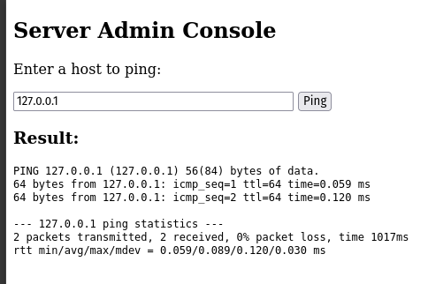
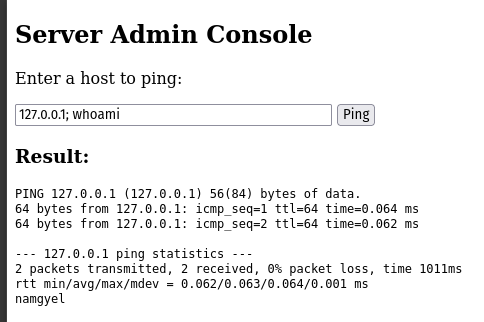
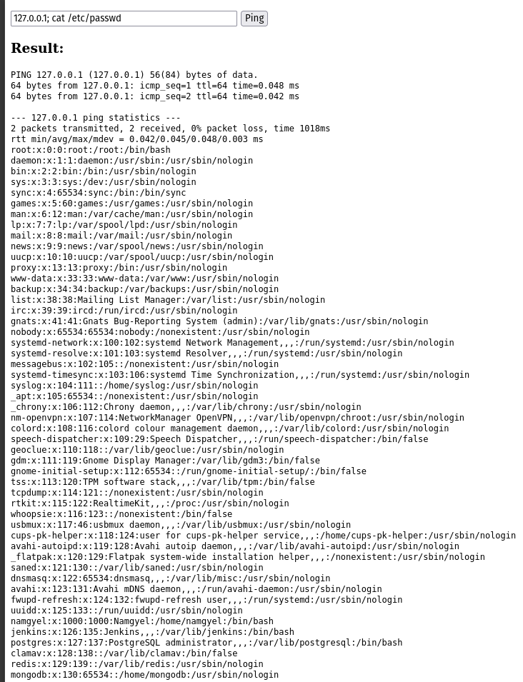
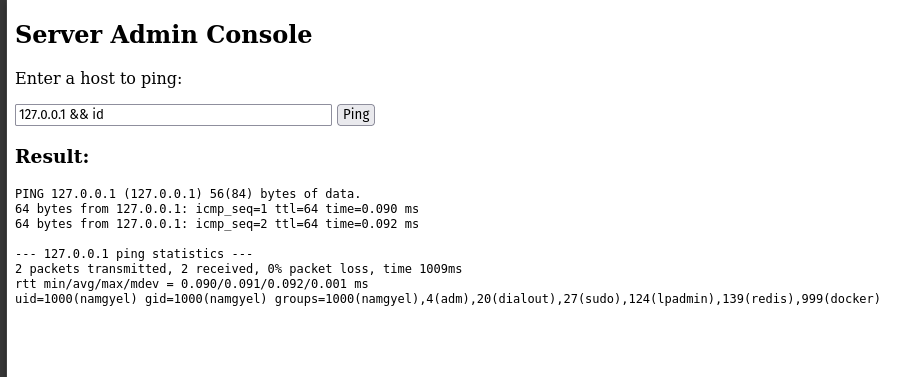
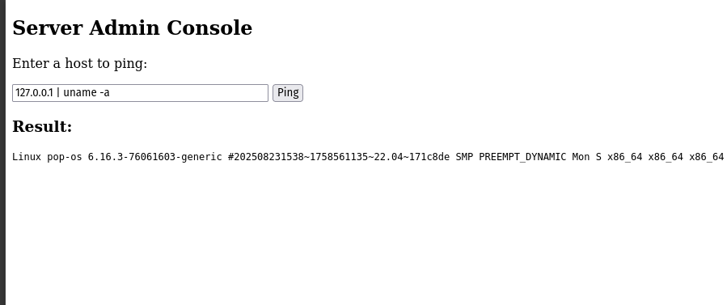
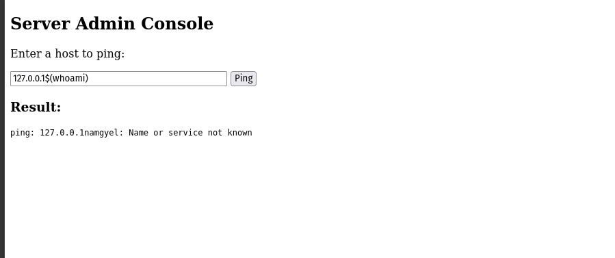
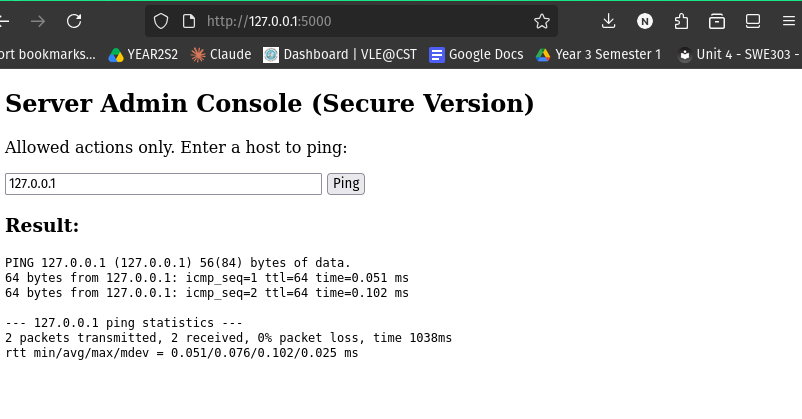
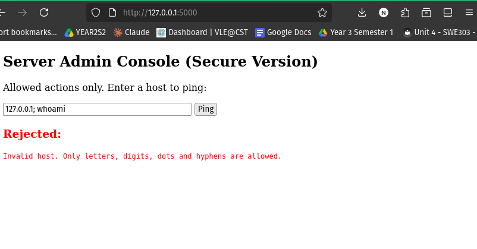
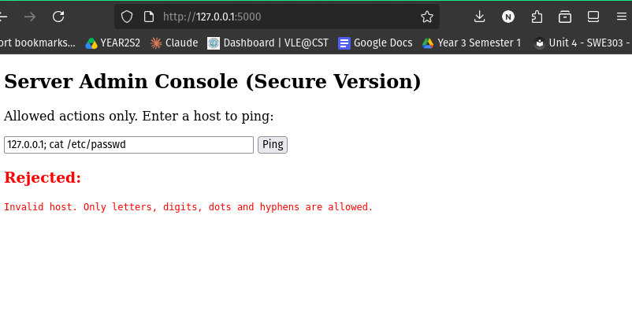
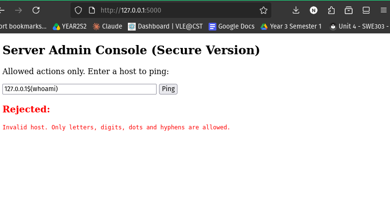

# Assignment 2: Command Injection — Building a Vulnerable Console and Securing It

## Table of Contents

1. [Introduction](#1-introduction)
2. [Lab Environment](#2-lab-environment)
3. [Part A: The Vulnerable Application](#3-part-a-the-vulnerable-application)
4. [Part B: Exploiting the Vulnerability](#4-part-b-exploiting-the-vulnerability)
5. [Part C: The Secure Application](#5-part-c-the-secure-application)
6. [Part D: Testing the Secure Application](#6-part-d-testing-the-secure-application)
7. [Before and After Comparison](#7-before-and-after-comparison)
8. [Discussion: Defence in Depth](#8-discussion-defence-in-depth)
9. [Conclusion](#9-conclusion)
10. [References](#10-references)

---

## 1. Introduction

**OS command injection** is a vulnerability that happens when a web application passes user input to the operating system's command shell without proper safety checks. If the application builds a shell command by joining text directly with user input, an attacker can add their own commands using shell characters such as `;`, `&&`, `|`, or `$()`. The server then runs those commands. This can lead to data theft, system changes, or complete takeover of the server.

### Aim

The aim of this assignment is to:

1. Build a simple web application with a command-line style interface (a "ping" console).
2. First build it in an **insecure** way and demonstrate command injection attacks against it.
3. Then build a **secure** version with layered safeguards.
4. Run the same attacks against the secure version to prove the safeguards work.
5. Explain why each defence works.

This follows the **attacker-then-defender** approach: you cannot defend well against an attack you have not seen succeed.

### Ethical Consideration

The vulnerable application in this assignment is **intentionally insecure**. It was run only on the local loopback address (`127.0.0.1`), which means it could be reached **only from my own computer** and was never exposed to any network. This keeps the demonstration safe and legal.

---

## 2. Lab Environment

| Item | Details |
|---|---|
| Operating System | Pop!_OS (Ubuntu-based Linux), kernel 6.16.3 |
| Language | Python 3.10 |
| Framework | Flask 3.1.3 |
| Isolation | Python virtual environment (`venv`) |
| Target address | `http://127.0.0.1:5000` (localhost only) |
| Browser | Firefox |

A virtual environment was used so that the project's Python packages stayed separate from the rest of the system.

```bash
python3 -m venv venv
source venv/bin/activate
pip install flask
```

---

## 3. Part A: The Vulnerable Application

The application is a "Server Admin Console". It shows a text box where the user enters a host, and the server runs `ping` against it and displays the result.

### 3.1 The Vulnerable Code

```python
# vulnerable_app.py  (key part)
import subprocess
from flask import Flask, request, render_template_string

@app.route("/", methods=["GET", "POST"])
def index():
    output = ""
    host = ""
    if request.method == "POST":
        host = request.form.get("host", "")
        # ---- THE VULNERABILITY ----
        command = "ping -c 2 " + host          # user input glued into a string
        result = subprocess.run(
            command, shell=True,               # the whole string goes to the shell
            capture_output=True, text=True
        )
        output = result.stdout + result.stderr
    return render_template_string(PAGE, output=output, host=host)
```

### 3.2 Why It Is Vulnerable

There are two mistakes, and together they create the vulnerability:

1. **The command is built by joining strings:** `"ping -c 2 " + host`. Whatever the user types becomes part of the command.
2. **`shell=True`:** this hands the entire string to the system shell (bash). The shell treats characters like `;`, `&&`, `|`, and `$()` as **instructions**, not as plain text.

So if a user types `127.0.0.1; whoami`, the shell sees two commands: first `ping -c 2 127.0.0.1`, then `whoami`.

### 3.3 Normal Behaviour (Before Attacking)

Before attacking, the application was tested with a normal input (`127.0.0.1`) to confirm it works correctly.

**Figure 1: Normal ping on the vulnerable app**



The application returned normal ping output, confirming it works as intended before any attack.

---

## 4. Part B: Exploiting the Vulnerability

Five attacks were performed, using different shell features. Using several operators shows that command injection is not caused by a single character, but by passing input to a shell at all.

### Attack 1: Command Chaining with Semicolon (`;`)

In a shell, `;` means "run the next command after this one."

**Input:**
```
127.0.0.1; whoami
```

**Result:** After the ping output, the server displayed a username (`namgyel`). This is the output of the `whoami` command, which the application was never meant to run.

**Figure 2: Semicolon injection running `whoami`**



**What this proves:** The attacker made the server run a command of their choice. The returned user (`namgyel`) is a normal user, not `root`, which slightly limits the immediate damage, but the injection itself is fully working.

### Attack 2: Reading a Sensitive File

**Input:**
```
127.0.0.1; cat /etc/passwd
```

**Result:** The server returned the full contents of `/etc/passwd`, which lists every user account on the system.

**Figure 3: Reading `/etc/passwd`**



**What this proves:** The attack leaks real data. Among the accounts, the output revealed that the machine runs other services such as **Jenkins, PostgreSQL, Redis, and MongoDB**. This gives an attacker a map of further targets, similar to how an exposed `.gitignore` leaked file locations in Assignment 1.

### Attack 3: Conditional Execution with `&&`

`&&` runs the next command only if the first one succeeds.

**Input:**
```
127.0.0.1 && id
```

**Result:**
```
uid=1000(namgyel) gid=1000(namgyel) groups=1000(namgyel),4(adm),20(dialout),
27(sudo),124(lpadmin),139(redis),999(docker)
```

**Figure 4: `&&` injection running `id`**



**What this proves — and why it is the most serious result:** The `id` command revealed the user's **group memberships**, and two of them are dangerous:

- **`sudo`** means this user can become root (full administrator).
- **`docker`** is a well-known privilege-escalation path. Any user in the `docker` group can start a container that mounts the whole filesystem and gives **root access without a password**.

This turns the attack from "run a command" into a realistic path to **full server takeover**:

```
command injection -> run `id` -> see victim is in the docker group
-> abuse Docker to gain root -> complete control of the machine
```

### Attack 4: Piping Output (`|`)

`|` sends the output of one command into another.

**Input:**
```
127.0.0.1 | uname -a
```

**Result:**
```
Linux pop-os 6.16.3-76061603-generic ... x86_64 GNU/Linux
```

**Figure 5: Pipe injection running `uname -a`**



**What this proves:** The exact **kernel version (6.16.3)** was leaked. An attacker uses this to look up matching privilege-escalation exploits. The normal ping output did not appear here, because the pipe sent ping's output into `uname` instead of to the screen, which confirms how `|` works.

### Attack 5: Command Substitution (`$()`)

`$(command)` runs the inner command first and substitutes its result into the line.

**Input:**
```
127.0.0.1$(whoami)
```

**Result:**
```
ping: 127.0.0.1namgyel: Name or service not known
```

**Figure 6: Command substitution injection**



**What this proves:** Although the ping failed, it tried to reach a host called `127.0.0.1namgyel`. The `namgyel` part is the output of `whoami`, which ran **before** ping. This is important because there is no `;`, `|`, or `&&` here. It demonstrates that simply blocking a few "bad" characters would not be enough, because injection can happen in many forms.

### 4.1 Summary of the Attacks

| Attack | Operator | Command run | Information gained |
|---|---|---|---|
| 1 | `;` | `whoami` | Current user |
| 2 | `;` | `cat /etc/passwd` | All user accounts and installed services |
| 3 | `&&` | `id` | Group membership (`sudo`, `docker`) -> takeover path |
| 4 | `\|` | `uname -a` | Kernel version -> exploit matching |
| 5 | `$()` | `whoami` | Injection without `;`, `\|`, or `&&` |

---

## 5. Part C: The Secure Application

The secure version keeps the same feature (ping a host) but adds **five layers of defence**. The core idea is: **never give user input to a shell.**

### 5.1 The Secure Code

```python
# secure_app.py  (key part)
import subprocess, re
from flask import Flask, request, render_template_string

# ---- DEFENCE 1: Input validation (character allowlist) ----
HOST_PATTERN = re.compile(r"^[a-zA-Z0-9.-]+$")

def is_valid_host(host):
    if not host or len(host) > 253:
        return False
    if not HOST_PATTERN.match(host):
        return False
    return True

@app.route("/", methods=["GET", "POST"])
def index():
    output = ""; error = ""; host = ""
    if request.method == "POST":
        host = request.form.get("host", "").strip()
        if not is_valid_host(host):
            error = "Invalid host. Only letters, digits, dots and hyphens are allowed."
        else:
            try:
                # ---- DEFENCE 2: No shell; arguments passed as a list ----
                # ---- DEFENCE 3: Fixed command (user can only ping) ----
                # ---- DEFENCE 4: Timeout ----
                result = subprocess.run(
                    ["ping", "-c", "2", host],
                    capture_output=True, text=True, timeout=10
                )
                if result.returncode == 0:
                    output = result.stdout
                else:
                    output = "Host could not be reached."   # DEFENCE 5: safe error
            except subprocess.TimeoutExpired:
                error = "The request timed out."
            except Exception:
                error = "An unexpected error occurred."
    return render_template_string(PAGE, output=output, error=error, host=host)
```

### 5.2 The Five Defences Explained

| # | Defence | How it works | Why it helps |
|---|---|---|---|
| 1 | **Input validation (allowlist)** | Accept only letters, digits, dots, hyphens. Reject everything else. | Dangerous characters (`;`, `\|`, `&`, `$`) are blocked before anything runs. An **allowlist** (allow known-good) is safer than a **blocklist** (ban known-bad), because Attack 5 showed attackers find characters a blocklist forgets. |
| 2 | **No shell; arguments as a list** | Pass `["ping", "-c", "2", host]` with `shell=False` (the default). | The `host` value is given to `ping` as **one single argument**. There is no shell to interpret special characters, so they become harmless plain text. **This is the main fix.** |
| 3 | **Fixed command** | The program is always `ping`. The user never chooses it. | The attacker cannot run `cat`, `id`, or any other program. |
| 4 | **Timeout** | `timeout=10` stops a command after 10 seconds. | Prevents a command from hanging the server (a denial-of-service protection). |
| 5 | **Safe errors + debug off** | Show generic messages; `debug=False`. | The application does not leak raw system errors or stack traces to the user (information disclosure). |

---

## 6. Part D: Testing the Secure Application

The secure application was first tested with a normal input to confirm it still works.

**Figure 7: Normal ping on the secure app**



The secure version still performs its real job correctly. Then the same five attacks from Part B were repeated.

### Result: All Attacks Blocked

**Figure 8: Semicolon attack rejected**



**Figure 9: `/etc/passwd` attack rejected**



Attacks using `;`, `cat /etc/passwd`, `&&`, and `|` were all stopped by **Defence 1 (input validation)**, because they contain characters that are not on the allowlist. The server displayed the message *"Invalid host. Only letters, digits, dots and hyphens are allowed."* and **no command was run**.

**Figure 10: Command substitution attack rejected**



The command substitution attack `127.0.0.1$(whoami)` was also rejected, because `$`, `(`, and `)` are not allowed characters.

### Results Table

| Attack | Input | Vulnerable App | Secure App |
|---|---|---|---|
| Semicolon | `127.0.0.1; whoami` | Ran `whoami` | **Rejected** (validation) |
| Read file | `127.0.0.1; cat /etc/passwd` | Leaked all accounts | **Rejected** (validation) |
| AND | `127.0.0.1 && id` | Leaked group info | **Rejected** (validation) |
| Pipe | `127.0.0.1 \| uname -a` | Leaked kernel version | **Rejected** (validation) |
| Substitution | `127.0.0.1$(whoami)` | Ran `whoami` | **Rejected** (validation) |

---

## 7. Before and After Comparison

| Aspect | Vulnerable Version | Secure Version |
|---|---|---|
| Command built by | Joining strings | Fixed list of arguments |
| Uses the shell? | Yes (`shell=True`) | No (`shell=False`) |
| User input checked? | No | Yes (allowlist) |
| User chooses the command? | Effectively yes (via injection) | No (ping only) |
| Timeout? | No | Yes (10s) |
| Error messages | Raw system output | Generic, safe |
| Result of attacks | All five succeeded | All five blocked |

---

## 8. Discussion: Defence in Depth

The secure application does not rely on a single protection. This is called **defence in depth**, and it is the main lesson of this assignment.

- **Defence 1 (validation)** stops bad input early. On its own, however, validation can have gaps or mistakes, and a developer might one day loosen the pattern.
- **Defence 2 (no shell)** is the safety net. Even if a dangerous character somehow passed validation, the input would still be treated as a single hostname and passed straight to `ping`, so no second command could run. At worst, `ping` would report "Name or service not known."

Because these two layers are **independent**, a single mistake does not break the whole system. If validation failed, "no shell" would still protect the server; if someone turned off validation, the list-based call would still prevent injection.

This matches the module's preventive measures against server-side attacks (Unit 2.7): **input validation and sanitisation**, and the **least privilege principle**. Attack 3 showed why least privilege matters: because the user was in the `sudo` and `docker` groups, a successful injection could have led to full root access. A production server should run the web application as a dedicated low-privilege user that is **not** in those groups, so that even a successful attack causes limited damage.

---

## 9. Conclusion

This assignment built a web console twice: once insecurely and once securely. The insecure version was exploited with five different shell operators (`;`, `&&`, `|`, and `$()`), which allowed reading system files, discovering installed services, and uncovering a realistic path to full server takeover through the `docker` group. The secure version blocked every one of these attacks.

The key lessons learned are:

1. **The root cause of command injection is passing user input to a shell.** Removing the shell (`shell=False` with arguments as a list) is the single most effective fix.
2. **Allowlists beat blocklists.** Trying to ban "bad" characters always misses something; allowing only known-good characters is safer.
3. **Use layers (defence in depth).** Validation and "no shell" back each other up, so one mistake does not expose the server.
4. **Least privilege limits the damage.** The `id` output showed that the account's group memberships would have made a real attack far worse.

---

## 10. References

- Hoffman, A. (2024). *Web Application Security: Exploitation and Countermeasures for Modern Web Applications* (2nd ed.). O'Reilly Media.
- McDonald, M. (2020). *Web Security for Developers: Real Threats, Practical Defense*. No Starch Press.
- Stuttard, D., & Pinto, M. (2011). *The Web Application Hacker's Handbook* (2nd ed.). John Wiley & Sons.
- OWASP Foundation. *Command Injection*. https://owasp.org/www-community/attacks/Command_Injection
- OWASP Foundation. *OS Command Injection Defense Cheat Sheet*. https://cheatsheetseries.owasp.org/cheatsheets/OS_Command_Injection_Defense_Cheat_Sheet.html
- MITRE. *CWE-78: Improper Neutralization of Special Elements used in an OS Command*. https://cwe.mitre.org/data/definitions/78.html
- Python Software Foundation. *subprocess — Subprocess management*. https://docs.python.org/3/library/subprocess.html