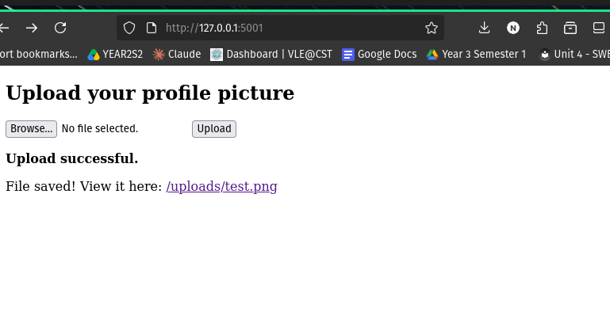
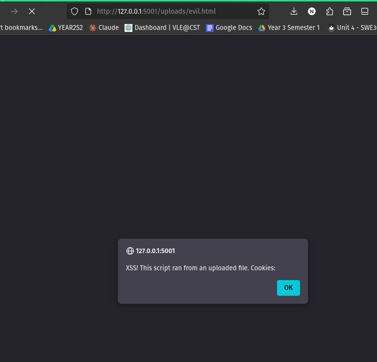
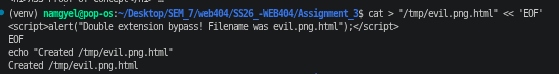
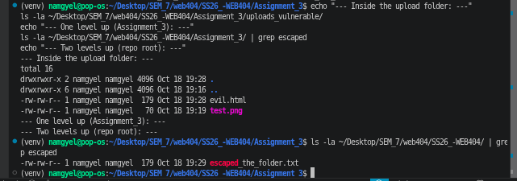
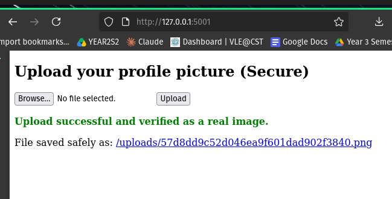
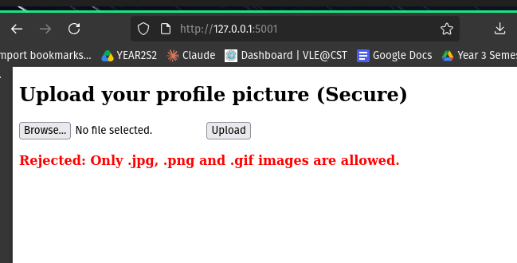
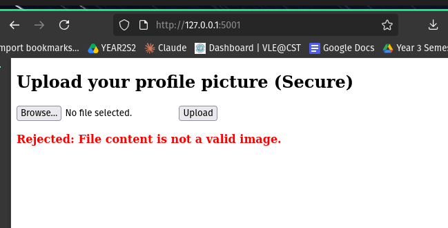
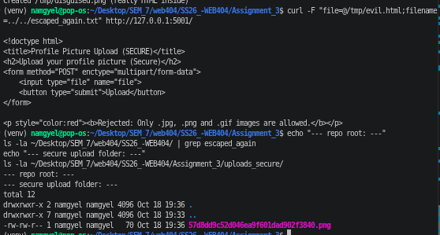

# Assignment 3: Secure File Upload — Building a Vulnerable Feature and Securing It

## Table of Contents

1. [Introduction](#1-introduction)
2. [Lab Environment](#2-lab-environment)
3. [Part A: The Vulnerable Application](#3-part-a-the-vulnerable-application)
4. [Part B: Exploiting the Vulnerability](#4-part-b-exploiting-the-vulnerability)
5. [Part C: The Secure Application](#5-part-c-the-secure-application)
6. [Part D: Testing the Secure Application](#6-part-d-testing-the-secure-application)
7. [Before and After Comparison](#7-before-and-after-comparison)
8. [Discussion and Limitations](#8-discussion-and-limitations)
9. [Conclusion](#9-conclusion)
10. [References](#10-references)

---

## 1. Introduction

Almost every modern web application lets users upload files: profile pictures, documents, attachments. A **file upload feature** is convenient, but if the server accepts and stores files without proper checks, it becomes one of the most dangerous entry points in an application. An attacker can upload a file that is not a harmless image but a **script** or a **malicious web page**, and then trick the server into storing or running it.

### Aim

The aim of this assignment is to:

1. Build a web application with a file upload feature (a profile picture uploader).
2. First build it **insecurely** and demonstrate several upload attacks against it.
3. Then build a **secure** version with layered safeguards.
4. Run the same attacks against the secure version to prove the safeguards work.
5. Explain why each defence works.

### Ethical Consideration

The vulnerable application is **intentionally insecure**. It was run only on the local loopback address (`127.0.0.1`), reachable **only from my own computer**, and was never exposed to any network. The malicious test files were simple, harmless proof-of-concept files (for example a script that only shows a popup). This keeps the demonstration safe and legal.

### A Note on the Technology Used

This assignment uses Python and Flask. The most famous file-upload attack is uploading a server-side script (such as a PHP web shell) that the server then executes. Flask does not execute PHP or arbitrary scripts from the upload folder, so instead the demonstration uses attacks that are fully effective in this stack: **stored cross-site scripting (XSS) through an uploaded HTML file**, a **double-extension bypass**, and **path traversal** through the filename. All three prove the same underlying lesson: the server trusted a file it should not have trusted.

---

## 2. Lab Environment

| Item | Details |
|---|---|
| Operating System | Pop!_OS (Ubuntu-based Linux) |
| Language | Python 3.10 |
| Framework | Flask 3.1.3 |
| Isolation | Python virtual environment (`venv`) |
| Target address | `http://127.0.0.1:5001` (localhost only) |
| Tools | Firefox, `curl` |

---

## 3. Part A: The Vulnerable Application

The application is a "Profile Picture Upload" page. The user chooses a file, uploads it, and the server saves it and provides a link to view it.

### 3.1 The Vulnerable Code

```python
# vulnerable_upload.py  (key part)
@app.route("/", methods=["GET", "POST"])
def index():
    if request.method == "POST":
        f = request.files.get("file")
        if f:
            # ---- THE VULNERABILITY ----
            # The user's filename is trusted completely: no checks, no renaming.
            filepath = os.path.join(UPLOAD_FOLDER, f.filename)
            f.save(filepath)

@app.route("/uploads/<path:name>")
def serve_upload(name):
    return send_from_directory(UPLOAD_FOLDER, name)
```

### 3.2 Why It Is Vulnerable

The application makes several mistakes:

1. **No type checking.** It accepts any file, including HTML and scripts, not just images.
2. **No content checking.** It never looks inside the file to confirm what it really is.
3. **It trusts the user's filename.** The name is used directly to save the file, so a name containing `../` can make the file escape the folder.
4. **It serves files back for rendering.** An uploaded HTML file is rendered by the browser, so any script inside it runs.

### 3.3 Normal Behaviour (Before Attacking)

The feature was first tested with a normal image to confirm it works.

**Figure 1: Normal image upload on the vulnerable app**



The image uploaded successfully and could be viewed through the generated link.

---

## 4. Part B: Exploiting the Vulnerability

### Attack 1: Stored XSS via an Uploaded HTML File

An image is passive, but an HTML file contains code that the browser runs. A malicious HTML file was created containing JavaScript:

```html
<script>
  alert("XSS! This script ran from an uploaded file. Cookies: " + document.cookie);
</script>
```

This file was uploaded and then opened through its link.

**Figure 2: Uploaded script executing in the browser**



**Result:** A JavaScript alert box appeared. The address bar shows `127.0.0.1:5001/uploads/evil.html`, and the alert header shows `127.0.0.1:5001`, which proves the script is running **in the context of the web application**, not as a local file.

**Why it is dangerous:** The script accesses `document.cookie`. On a real site with logged-in users, an attacker would not show a popup but would silently send the victim's **session cookies** to themselves, allowing them to hijack the victim's account. Because the file is stored on the server, every user who opens it is attacked. This is **stored XSS**.

**Severity:** High. **Syllabus link:** Unit 2.3 File Upload; Unit 4.1 Cross-site Scripting.

### Attack 2: Double Extension Bypass

Many weak filters only look for an image keyword in the filename. A file named `evil.png.html` contains `.png` but is really an HTML file. This was uploaded to show the trick.

**Figure 3: Double-extension file executing as HTML**



**Result:** The script still ran. The `.png` in the middle of the name would fool any filter that simply searched for "png", yet the browser treated the file as HTML because of its true `.html` ending.

**Why it is dangerous:** It shows that checking only the filename is not enough, because filenames can be crafted to slip past naive checks.

**Severity:** High. **Syllabus link:** Unit 2.3.2 File type and content validation.

### Attack 3: Path Traversal Through the Filename

A filename can secretly contain a path. A filename of `../../escaped_the_folder.txt` means "go up two folders before saving." Because browsers strip `../` from the file picker, the upload was sent directly with `curl`, which allows any filename:

```bash
curl -F "file=@/tmp/evil.html;filename=../../escaped_the_folder.txt" http://127.0.0.1:5001/
```

The locations were then checked:

**Figure 4: Uploaded file escaping the upload folder**



**Result:** The file `escaped_the_folder.txt` was saved **two folders above** the upload directory, in the repository root, instead of inside `uploads_vulnerable`. The attacker, not the server, controlled where the file was written. The application even generated the link `/uploads/../../escaped_the_folder.txt`, pointing outside its own folder.

**Why it is dangerous:** On a real server, an attacker could overwrite important files, such as configuration files or the application's own code, or place a file in a folder where it would be executed.

**Severity:** High. **Syllabus link:** Unit 2.2 Directory Traversal; Unit 2.3.3 Secure file handling.

### 4.1 Summary of the Attacks

| Attack | Technique | What it proved |
|---|---|---|
| 1 | Upload HTML with JavaScript | Uploaded script runs in the browser (stored XSS) |
| 2 | `evil.png.html` double extension | Naive name filters can be bypassed |
| 3 | `../../` in the filename (via curl) | File saved outside the intended folder |

---

## 5. Part C: The Secure Application

The secure version keeps the same feature but adds **five layers of defence**. The core idea is: **never trust the uploaded file's name or its claimed type; verify the real content and control the name and location yourself.**

### 5.1 The Secure Code

```python
# secure_upload.py  (key parts)
import os, uuid, imghdr

ALLOWED_TYPES = {"jpeg", "png", "gif"}
ALLOWED_EXTENSIONS = {".jpg", ".jpeg", ".png", ".gif"}
app.config["MAX_CONTENT_LENGTH"] = 5 * 1024 * 1024   # Defence 5: size limit

@app.route("/", methods=["GET", "POST"])
def index():
    if request.method == "POST":
        f = request.files.get("file")
        if not f or f.filename == "":
            error = "No file selected."
        else:
            # ---- DEFENCE 2: extension allowlist ----
            ext = os.path.splitext(f.filename)[1].lower()
            if ext not in ALLOWED_EXTENSIONS:
                error = "Only .jpg, .png and .gif images are allowed."
            else:
                # ---- DEFENCE 3: verify REAL content (magic bytes) ----
                header = f.stream.read(512)
                f.stream.seek(0)
                real_type = imghdr.what(None, h=header)
                if real_type not in ALLOWED_TYPES:
                    error = "File content is not a valid image."
                else:
                    # ---- DEFENCE 4: we choose a random safe name ----
                    safe_name = f"{uuid.uuid4().hex}.{real_type}"
                    f.save(os.path.join(UPLOAD_FOLDER, safe_name))

@app.route("/uploads/<name>")   # no <path:>, so slashes are blocked
def serve_upload(name):
    return send_from_directory(UPLOAD_FOLDER, name, as_attachment=True)
```

### 5.2 The Five Defences Explained

| # | Defence | How it works | Which attack it stops |
|---|---|---|---|
| 1 | **File size limit** | `MAX_CONTENT_LENGTH` rejects files over 5 MB. | Denial of service (filling the disk). |
| 2 | **Extension allowlist** | Only `.jpg`, `.png`, `.gif` names are accepted. | The `.html` upload (Attack 1). |
| 3 | **Real content check** | `imghdr` reads the file's first bytes (magic numbers) to confirm it is truly an image. | A script renamed to `.png` (the disguised version of Attack 2). |
| 4 | **Random renaming** | The user's filename is thrown away and replaced with a random name like `a3f8...png`. | Path traversal (Attack 3), because any `../` is discarded. |
| 5 | **Safe serving** | The route uses `<name>` (no slashes) and `as_attachment=True` forces download instead of rendering. | Any file that slips through cannot run in the browser. |

The most important defence is **number 3**. Checking the filename alone is weak, because names can be faked. Reading the actual content is what truly confirms the file is an image.

---

## 6. Part D: Testing the Secure Application

The secure application was first tested with a normal image.

**Figure 5: Normal image accepted and renamed by the secure app**



**Result:** The image was accepted, verified as a real image, and saved with a **random filename** (for example `57d8dd9c52d046ea9f601dad902f3840.png`). The original filename was discarded. The feature still works for legitimate users.

The three attacks were then repeated.

### Attack 1 blocked: HTML upload

**Figure 6: HTML upload rejected**



**Result:** Rejected with "Only .jpg, .png and .gif images are allowed." The `.html` extension failed Defence 2, so no file was saved.

### Attack 2 blocked: disguised file (the key test)

A real HTML file was copied to `disguised.png` so that its **name** would pass the extension check, and then uploaded.

**Figure 7: Disguised file rejected by content inspection**



**Result:** Rejected with "File content is not a valid image." This is the most important result. The file passed the extension check (its name ended in `.png`), but Defence 3 read the actual bytes, saw they were not an image, and refused it. This proves why **content verification** is needed on top of extension checks.

### Attack 3 blocked: path traversal

The same `curl` path-traversal attack was repeated against the secure app, and the locations were checked.

**Figure 8: Path traversal blocked, nothing escaped**



**Result:** The file did **not** appear in the repository root or anywhere outside the upload folder. The upload folder contained only the earlier legitimate image. The attack was rejected (the `.txt` extension failed Defence 2), and even an image-named traversal attempt would be defeated by Defence 4, which discards the filename entirely.

### Results Table

| Attack | Vulnerable App | Secure App |
|---|---|---|
| HTML/XSS upload | Script executed in browser | **Rejected** (extension check) |
| Disguised `.png` (real HTML) | Would be saved and run | **Rejected** (content check) |
| Path traversal (`../../`) | File escaped to repo root | **Rejected**; nothing escaped |

---

## 7. Before and After Comparison

| Aspect | Vulnerable Version | Secure Version |
|---|---|---|
| Checks file extension? | No | Yes (allowlist) |
| Checks real file content? | No | Yes (`imghdr` magic bytes) |
| Who chooses the filename? | The user | The server (random name) |
| File size limit? | No | Yes (5 MB) |
| Serves files how? | Renders in browser | Forces download |
| Path traversal possible? | Yes | No |
| Result of attacks | All succeeded | All blocked |

---

## 8. Discussion and Limitations

### Defence in Depth

The secure application does not rely on a single check. The three attacks were stopped by **different layers**: the extension allowlist caught the obvious `.html`, the content check caught the disguised `.png`, and the random renaming neutralised path traversal. Because the layers are independent, a mistake in one does not expose the whole system. This is the **defence in depth** principle, and it matches the module's preventive measures in Unit 2.3.3 and 2.7.

### Limitations of This Demonstration

- **Flask does not execute uploaded scripts.** In a PHP/Apache environment, the classic attack would be uploading a `.php` web shell that the server runs, giving command execution. This demonstration used stored XSS, double extension, and path traversal instead, which are fully effective in Flask and prove the same root cause. The defences built here (content verification, renaming, storing safely) also prevent the PHP web shell attack.
- **`imghdr` is deprecated** and was removed in Python 3.13. It worked on Python 3.10 used here. In a production system, a maintained library such as Pillow should be used to verify images, and ideally images should be re-encoded to strip any hidden malicious data.
- **Further hardening** on a real server would include storing uploads outside the web root, disabling script execution in the upload folder (for example with server configuration), scanning files with anti-virus, and serving uploads from a separate domain.

---

## 9. Conclusion

This assignment built a file upload feature twice: once insecurely and once securely. The insecure version was exploited with three attacks: stored XSS through an HTML upload, a double-extension bypass, and path traversal that wrote a file outside the intended folder. The secure version blocked all three using layered defences.

The key lessons learned are:

1. **Never trust the filename.** It can contain fake extensions or path characters, so the server must generate its own safe name.
2. **Check the real content, not just the name.** Reading the file's magic bytes catches files that lie about their type, which is the single most important upload defence.
3. **Control where files go and how they are served.** Renaming, a fixed folder, and forcing download instead of rendering prevent uploaded files from being executed.
4. **Use layers (defence in depth).** Each attack was stopped by a different safeguard, so one weakness does not break the whole system.

---

## 10. References

- Hoffman, A. (2024). *Web Application Security: Exploitation and Countermeasures for Modern Web Applications* (2nd ed.). O'Reilly Media.
- McDonald, M. (2020). *Web Security for Developers: Real Threats, Practical Defense*. No Starch Press.
- Stuttard, D., & Pinto, M. (2011). *The Web Application Hacker's Handbook* (2nd ed.). John Wiley & Sons.
- OWASP Foundation. *Unrestricted File Upload*. https://owasp.org/www-community/vulnerabilities/Unrestricted_File_Upload
- OWASP Foundation. *File Upload Cheat Sheet*. https://cheatsheetseries.owasp.org/cheatsheets/File_Upload_Cheat_Sheet.html
- MITRE. *CWE-434: Unrestricted Upload of File with Dangerous Type*. https://cwe.mitre.org/data/definitions/434.html
- Python Software Foundation. *Flask Documentation: Uploading Files*. https://flask.palletsprojects.com/