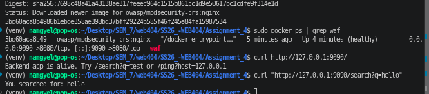
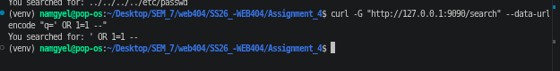
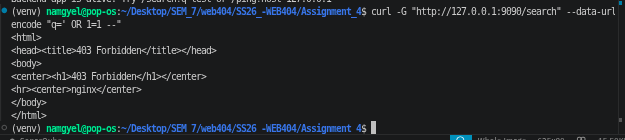
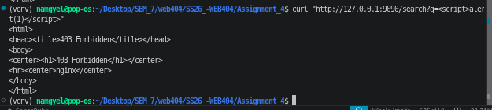
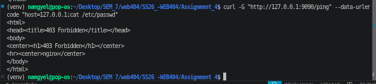
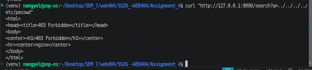
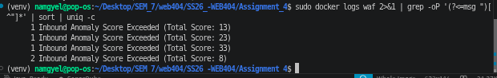

# Assignment 4: Configuring and Testing a Web Application Firewall (WAF)

| | |
|---|---|
| **Module** | WEB404 Secure Coding Practices |
| **Programme** | BE in Software Engineering |
| **Assignment** | Practical Assignment 4 |
| **Student Name** | *Your Name* |
| **Student ID** | *Your Student ID* |
| **Module Tutor** | *Tutor Name* |
| **Date** | 21 October 2026 |

---

## Table of Contents

1. [Introduction](#1-introduction)
2. [Lab Environment and Architecture](#2-lab-environment-and-architecture)
3. [Part A: Setting Up the WAF](#3-part-a-setting-up-the-waf)
4. [Part B: Attacks With the WAF in Detection Mode](#4-part-b-attacks-with-the-waf-in-detection-mode)
5. [Part C: Attacks With the WAF in Blocking Mode](#5-part-c-attacks-with-the-waf-in-blocking-mode)
6. [Part D: Understanding How the WAF Blocked the Attacks](#6-part-d-understanding-how-the-waf-blocked-the-attacks)
7. [Before and After Comparison](#7-before-and-after-comparison)
8. [Discussion and Limitations](#8-discussion-and-limitations)
9. [Conclusion](#9-conclusion)
10. [References](#10-references)

---

## 1. Introduction

A **Web Application Firewall (WAF)** is a security layer that sits in front of a web application and inspects every incoming request. If a request looks like an attack, such as SQL injection or cross-site scripting, the WAF blocks it **before it ever reaches the application**. A useful way to picture it is a security guard at the door of a shop: the guard checks everyone coming in and stops anyone carrying something dangerous, so the staff inside are never exposed.

The key idea is that a WAF protects the application **even if the application's own code is insecure**. It is an extra layer of defence, not a replacement for secure coding.

### Aim

The aim of this assignment is to:

1. Set up a WAF (ModSecurity with the OWASP Core Rule Set) in front of a web application.
2. Send common server-side attacks through it with blocking turned **off**, to confirm the attacks reach the application.
3. Turn blocking **on** and send the same attacks, to confirm they are blocked.
4. Examine the WAF logs to understand **how** it decided to block each attack.

### Tools Chosen

The WAF is **ModSecurity** combined with the **OWASP Core Rule Set (CRS)**, the industry-standard open-source combination referenced in the module (Unit 2.7.4). It was run using the official `owasp/modsecurity-crs` Docker image. The application behind it is a small, purpose-built Flask app that simply echoes back whatever it receives. This simple backend was chosen deliberately: because its behaviour is completely predictable, any blocked request is clearly the WAF's doing and not a side effect of the application.

### Ethical Consideration

All testing was performed on the local machine only (`127.0.0.1`). No external system was involved. The attack payloads were standard, well-known test strings used only against the local lab.

---

## 2. Lab Environment and Architecture

| Item | Details |
|---|---|
| Operating System | Pop!_OS (Ubuntu-based Linux) |
| Container Platform | Docker |
| WAF | ModSecurity + OWASP CRS (`owasp/modsecurity-crs:nginx`) |
| Backend app | Python 3 / Flask (echo app) |
| Test tool | `curl` |

### Architecture

```
  You (curl / browser)
          |
          v
  +-------------------------+
  |  WAF  (port 9090)       |   <- ModSecurity + OWASP CRS
  |  inspects every request |      blocks attacks here
  +-------------------------+
          |  (only clean requests pass)
          v
  +-------------------------+
  |  Flask backend (8500)   |   <- echoes back what it receives
  +-------------------------+
```

The WAF listens on port **9090**. When a request is clean, it forwards it to the Flask backend on port **8500**. When a request is an attack (in blocking mode), the WAF stops it and returns **403 Forbidden**, so the backend never sees it.

### Note on Ports

Ports 8080 and 8000 were already in use on the host (by another process and another Docker container), so port **9090** was chosen for the WAF and **8500** for the backend. This kind of port check and adjustment is a normal part of setting up a lab.

---

## 3. Part A: Setting Up the WAF

The backend app was started first, then the WAF container was started in front of it.

The WAF container was run with these key settings:

```bash
sudo docker run -d --name waf \
  -p 9090:8080 \
  --add-host=host.docker.internal:host-gateway \
  -e BACKEND=http://host.docker.internal:8500 \
  -e MODSEC_RULE_ENGINE=DetectionOnly \
  owasp/modsecurity-crs:nginx
```

| Setting | Meaning |
|---|---|
| `-p 9090:8080` | The WAF is reached on port 9090. |
| `--add-host=...:host-gateway` | Lets the container reach the backend running on the host. |
| `-e BACKEND=...:8500` | Tells the WAF where to forward clean traffic. |
| `-e MODSEC_RULE_ENGINE=DetectionOnly` | Starts the WAF in **watching** mode: it detects and logs attacks but does not block them yet. |

**Figure 1: The WAF container running and forwarding traffic**



The container shows as `Up (healthy)` with port `9090->8080`, and a normal request to `http://127.0.0.1:9090/` returned the backend's message. This confirms the full chain works: request → WAF → backend.

---

## 4. Part B: Attacks With the WAF in Detection Mode

With the WAF in **DetectionOnly** mode, four common server-side attacks were sent. In this mode the WAF watches and logs but does not block, so this is the "before" baseline showing that the attacks reach the application.

| # | Attack | Payload sent |
|---|---|---|
| 1 | SQL Injection | `q=' OR 1=1 --` |
| 2 | Cross-site Scripting (XSS) | `q=<script>alert(1)</script>` |
| 3 | Command Injection | `host=127.0.0.1;cat /etc/passwd` |
| 4 | Path Traversal | `q=../../../../etc/passwd` |

Example command (SQL injection):

```bash
curl -G "http://127.0.0.1:9090/search" --data-urlencode "q=' OR 1=1 --"
```

**Figure 2: SQL injection payload reaching the backend in detection mode**



**Result:** All four payloads were **echoed back by the backend**, for example `You searched for: ' OR 1=1 --`. This proves the attacks passed straight through to the application while the WAF was only watching.

---

## 5. Part C: Attacks With the WAF in Blocking Mode

The WAF was then restarted with one setting changed: `MODSEC_RULE_ENGINE=On`, which turns on active blocking.

```bash
sudo docker rm -f waf
sudo docker run -d --name waf \
  -p 9090:8080 \
  --add-host=host.docker.internal:host-gateway \
  -e BACKEND=http://host.docker.internal:8500 \
  -e MODSEC_RULE_ENGINE=On \
  owasp/modsecurity-crs:nginx
```

Before attacking, a normal request was tested again and still returned the backend's message. This is important: a correctly tuned WAF blocks attacks **but still lets legitimate traffic through**.

The same four attacks were then repeated.

**Figure 3: SQL injection blocked with 403 Forbidden**



The response now begins with `HTTP/1.1 403 Forbidden` instead of echoing the payload. The request was stopped at the WAF and never reached the backend.

**Figure 4: XSS blocked**



**Figure 5: Command injection blocked**



**Figure 6: Path traversal blocked**



**Result:** All four attacks returned **403 Forbidden**. The only thing that changed between Part B and Part C was the WAF's rule engine setting, which proves the WAF is responsible for blocking.

---

## 6. Part D: Understanding How the WAF Blocked the Attacks

The OWASP CRS does not simply block on a single match. It uses an **anomaly scoring** system: each suspicious feature of a request adds points, and when the total passes a threshold (the default is 5), the request is blocked by rule **949110**.

The WAF logs were examined:

```bash
sudo docker logs waf 2>&1 | grep -oP '(?<=msg ")[^"]*' | sort | uniq -c
```

**Figure 7: WAF log showing anomaly scores for the blocked attacks**



**Result:** The log showed that each attack exceeded the anomaly threshold, with different total scores:

| Attack | Anomaly Score (from log) |
|---|---|
| A simpler attack | 8 |
| Path traversal | 13 |
| XSS | 23 |
| Command injection | 33 |

The rule-ID breakdown showed rule **949110** firing five times. This is the CRS rule that enforces blocking once the anomaly score is exceeded. The higher scores (such as 33) mean the payload tripped many individual rules at once, because a string like `127.0.0.1;cat /etc/passwd` looks suspicious in several different ways (a semicolon, a command name, and a sensitive file path).

This confirms **how** the WAF works: it adds up evidence from many rules and blocks when the total is high enough, rather than relying on one exact signature.

---

## 7. Before and After Comparison

| Attack | WAF Detection Mode | WAF Blocking Mode |
|---|---|---|
| SQL Injection | Reached backend (echoed) | **403 Forbidden** |
| XSS | Reached backend (echoed) | **403 Forbidden** |
| Command Injection | Reached backend (echoed) | **403 Forbidden** |
| Path Traversal | Reached backend (echoed) | **403 Forbidden** |
| Normal request | Reached backend | Reached backend (still allowed) |

The last row is important: legitimate traffic continued to work in both modes. The WAF distinguishes attacks from normal use.

---

## 8. Discussion and Limitations

### What This Demonstrates

A single configuration change (DetectionOnly → On) turned a passive monitor into an active shield that blocked four different categories of server-side attack, **without any change to the backend application's code**. This is the main value of a WAF: it adds protection in front of an application, which is especially useful for legacy applications that cannot easily be rewritten. It directly supports the module's preventive measures in Unit 2.7.4.

### Detection Mode Is Useful in Practice

The two modes are not just an exercise. In real deployments, a WAF is usually run in detection mode first, so that administrators can see what it *would* block and fix any false positives, before switching to blocking mode on live traffic. This avoids accidentally blocking real users.

### Limitations

- **A WAF is not a complete solution.** It reduces risk but can be bypassed by cleverly crafted or encoded payloads. It should be used **together with** secure coding (input validation, parameterised queries, output encoding), not instead of it. In other words, it is one layer of defence in depth.
- **False positives are possible.** Because the CRS blocks on an anomaly score, an unusual but legitimate request could be blocked. This is why tuning and detection mode matter.
- **This image logs summaries to standard output.** The container was configured to send its logs to stdout (captured with `docker logs`) rather than writing detailed audit files, so the logs here show the anomaly scores and the blocking rule (949110) rather than a separate named line per attack type. The scores and the blocking rule are still sufficient to show how and why each request was blocked.
- **The backend was a simple echo app.** It did not actually execute the attacks; it only showed whether the payload reached it. This was intentional, so that the WAF's effect could be measured cleanly.

---

## 9. Conclusion

This assignment set up ModSecurity with the OWASP Core Rule Set as a WAF in front of a web application, then tested it against SQL injection, XSS, command injection, and path traversal. With blocking off, all four attacks reached the application. With blocking on, all four were stopped with 403 Forbidden, while normal traffic still passed. The logs showed that the WAF used anomaly scoring to make these decisions.

The key lessons learned are:

1. **A WAF blocks attacks before they reach the application**, protecting it even when the application code itself is weak.
2. **The OWASP CRS uses anomaly scoring**, adding points from many rules and blocking when a threshold is crossed, which is more flexible than matching a single signature.
3. **Detection mode comes first in practice**, so that false positives can be found and fixed before blocking real users.
4. **A WAF is one layer, not the whole defence.** It should be combined with secure coding practices for proper defence in depth.

---

## 10. References

- Hoffman, A. (2024). *Web Application Security: Exploitation and Countermeasures for Modern Web Applications* (2nd ed.). O'Reilly Media.
- McDonald, M. (2020). *Web Security for Developers: Real Threats, Practical Defense*. No Starch Press.
- Stuttard, D., & Pinto, M. (2011). *The Web Application Hacker's Handbook* (2nd ed.). John Wiley & Sons.
- OWASP Foundation. *OWASP ModSecurity Core Rule Set*. https://coreruleset.org/
- OWASP Foundation. *ModSecurity*. https://github.com/owasp-modsecurity/ModSecurity
- OWASP Foundation. *OWASP CRS Docker Image*. https://github.com/coreruleset/modsecurity-crs-docker
- OWASP Foundation. *Web Application Firewall*. https://owasp.org/www-community/Web_Application_Firewall