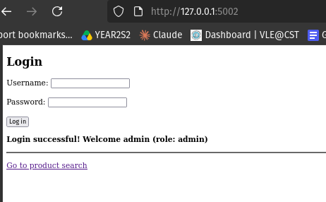
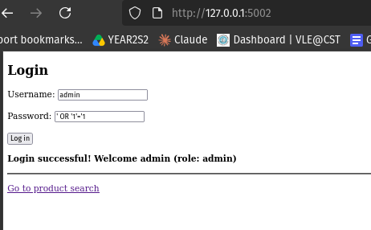
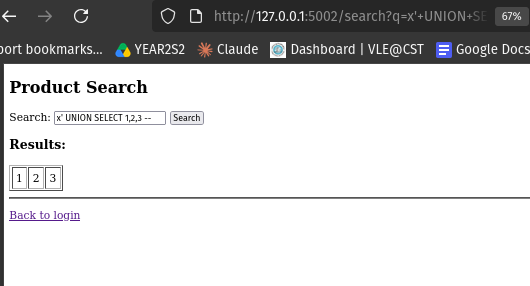
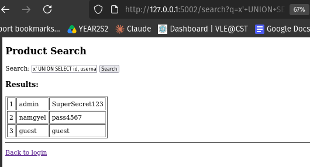
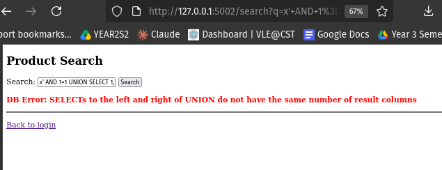
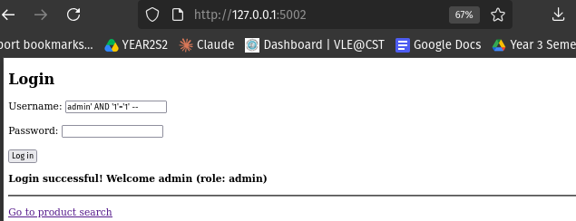
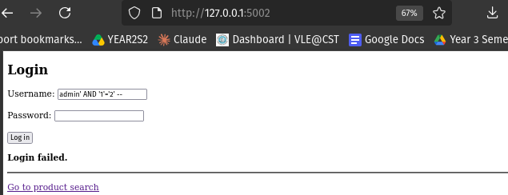
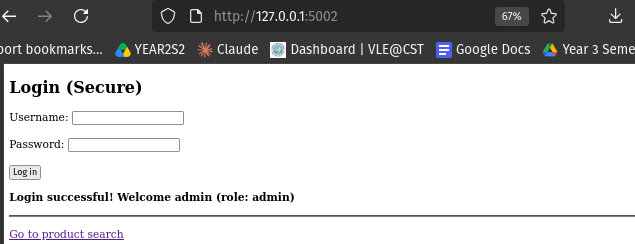
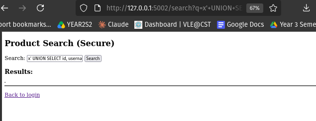
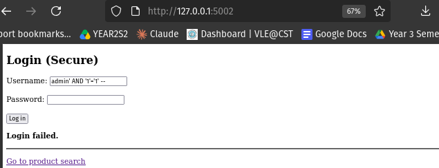

# Assignment 5: SQL Injection — Attacking a Vulnerable Application and Securing It

## Table of Contents

1. [Introduction](#1-introduction)
2. [Lab Environment](#2-lab-environment)
3. [Part A: The Vulnerable Application](#3-part-a-the-vulnerable-application)
4. [Part B: Performing SQL Injection Attacks](#4-part-b-performing-sql-injection-attacks)
5. [Part C: The Secure Application](#5-part-c-the-secure-application)
6. [Part D: Testing the Secure Application](#6-part-d-testing-the-secure-application)
7. [Before and After Comparison](#7-before-and-after-comparison)
8. [Discussion](#8-discussion)
9. [Conclusion](#9-conclusion)
10. [References](#10-references)

---

## 1. Introduction

**SQL injection (SQLi)** is a vulnerability that occurs when a web application builds a database query by joining user input directly into the SQL command text. Because the input is mixed into the command, an attacker can type special characters, especially the single quote `'`, to break out of the intended value and rewrite the query. This can allow logging in without a password, reading data from other tables, or damaging the database.

A simple way to picture it: the application means to ask the database one question, but the attacker's input changes the question into a different one.

### Aim

The aim of this assignment is to:

1. Build a vulnerable web application backed by a real database.
2. Perform **several types** of SQL injection against it: authentication bypass, UNION-based data theft, error-based injection, and blind injection.
3. Build a secure version using **parameterised queries**.
4. Repeat the attacks to prove the secure version is protected.

### Ethical Consideration

The application is **intentionally vulnerable** and was run only on the local machine (`127.0.0.1`). The data inside it is fake sample data created for the exercise. No real system or real credentials were involved.

---

## 2. Lab Environment

| Item | Details |
|---|---|
| Operating System | Pop!_OS (Ubuntu-based Linux) |
| Language | Python 3 |
| Framework | Flask |
| Database | SQLite (built into Python) |
| Target address | `http://127.0.0.1:5002` (localhost only) |
| Tools | Firefox web browser |

SQLite was chosen because it needs no separate database server, yet it processes real SQL and is vulnerable to injection in exactly the same way as larger databases such as MySQL. The attacks demonstrated here transfer directly to other databases.

The sample database contains two tables: a `users` table (with an `admin` account) and a `products` table. The goal of some attacks is to steal the user credentials through the product search.

---

## 3. Part A: The Vulnerable Application

The application has two features: a **login page** and a **product search page**.

### 3.1 The Vulnerable Code

```python
# Login (vulnerable): user input is glued straight into the SQL string.
query = f"SELECT * FROM users WHERE username = '{username}' AND password = '{password}'"
cur.execute(query)

# Search (vulnerable): same mistake.
query = f"SELECT id, name, price FROM products WHERE name LIKE '%{q}%'"
cur.execute(query)
```

### 3.2 Why It Is Vulnerable

Both queries are built with an **f-string** that inserts user input directly into the SQL command. The database cannot tell which part is the developer's command and which part is the user's input, so if the input contains SQL characters, the database obeys them as commands. This single mistake is the root cause of every attack below.

### 3.3 Normal Behaviour (Before Attacking)

The application was first tested normally: logging in as `admin` with the correct password succeeded, a wrong password failed, and searching for a product returned that product.

**Figure 1: Normal successful login**



---

## 4. Part B: Performing SQL Injection Attacks

Four different types of SQL injection were performed.

### Attack 1: Authentication Bypass

The login query is `... WHERE username = '<input>' AND password = '<input>'`. Entering the following as the **password** makes the condition always true:

```
' OR '1'='1
```

The query becomes `... AND password = '' OR '1'='1'`. Because `'1'='1'` is always true, the database returns a user and the login succeeds.

**Figure 2: Logged in as admin with no valid password**



**Result:** Login succeeded as **admin** without knowing the password. A variation, entering `admin' --` in the username field, uses `--` to comment out the password check entirely, allowing login as any named user.

**Impact:** Complete bypass of authentication. **Syllabus link:** Unit 2.1, Unit 2.6 (authentication bypass).

### Attack 2: UNION-Based Data Theft

The `UNION` keyword joins the results of a second query onto the first. Since the product search returns **three columns**, the injected query must also select three columns.

**Step 1 — confirm the column count:**
```
x' UNION SELECT 1,2,3 --
```

**Figure 3: Confirming the query returns three columns**



A row showing `1 | 2 | 3` confirmed three columns.

**Step 2 — steal the user credentials:**
```
x' UNION SELECT id, username, password FROM users --
```

**Figure 4: Stealing all usernames and passwords through the search box**



**Result:** The product search returned **every username and password in the database**, including `admin / SuperSecret123`. A search feature that was only meant to show products was used to steal the entire credentials table.

**Impact:** Full data breach. This is the most serious result. **Syllabus link:** Unit 2.1.1.

### Attack 3: Error-Based SQL Injection

Sometimes the database leaks information through its **error messages**. An injected query with a mismatched structure forces an error:

```
x' AND 1=1 UNION SELECT 1,2 --
```

**Figure 5: The database leaking information through an error message**



**Result:** The page displayed a detailed database error (for example, that the two sides of the UNION have different numbers of columns). This error **is itself the leak**: it tells the attacker how the query is structured, which helps them build further attacks.

**Impact:** Information disclosure that assists other attacks. **Syllabus link:** Unit 2.1, Unit 2.4 (error message handling).

### Attack 4: Blind SQL Injection

"Blind" injection is used when the page shows **no data and no error**. Instead, the attacker asks **true/false questions** and watches how the response changes. Using the login page, two almost identical inputs were entered in the username field:

- True condition: `admin' AND '1'='1' --`
- False condition: `admin' AND '1'='2' --`

The `--` comments out the password check, so only the condition decides the result.

**Figure 6: True condition — login succeeds**



**Figure 7: False condition — login fails**



**Result:** The true condition produced "Login successful" and the false condition produced "Login failed." The two inputs differ only by `1` versus `2`, yet the responses differ. This **difference is the leak**: an attacker can replace the condition with real questions (for example, "is the first letter of the admin password 'S'?") and read the answer from whether the login succeeds, extracting data one character at a time.

**Impact:** Data extraction even with no visible output. **Syllabus link:** Unit 2.1.2 (Blind SQL injection).

### 4.1 Summary of the Attacks

| # | Attack type | Technique | Impact |
|---|---|---|---|
| 1 | Authentication bypass | `' OR '1'='1` | Logged in without a password |
| 2 | UNION-based | `UNION SELECT ... FROM users` | Stole all credentials |
| 3 | Error-based | Mismatched UNION | Leaked query structure |
| 4 | Blind | `AND '1'='1'` vs `'1'='2'` | Extract data via true/false |

---

## 5. Part C: The Secure Application

The secure version keeps the same features but fixes the root cause using **parameterised queries** (also called prepared statements).

### 5.1 The Secure Code

```python
# Login (secure): ? placeholders keep input as DATA, never as SQL.
cur.execute(
    "SELECT * FROM users WHERE username = ? AND password = ?",
    (username, password)
)

# Search (secure): the search term is passed separately.
cur.execute(
    "SELECT id, name, price FROM products WHERE name LIKE ?",
    ('%' + q + '%',)
)
```

### 5.2 Why This Is Secure

With a parameterised query, the SQL command and the user's input are sent to the database **separately**. The `?` is a placeholder, and the value is handed over on its own. The database treats that value as pure **data** and never as part of the command.

So if an attacker enters `' OR '1'='1`, the database looks for a user whose username is literally the text `' OR '1'='1` and finds none. The single quotes lose all their power, because they are never interpreted as SQL. This one change defeats **all four** attacks at once.

Two extra hardening measures were also added:

- **Generic error messages.** The secure app shows "Something went wrong" instead of the raw database error, which closes the error-based channel (Unit 2.4).
- **Debug mode off.** This prevents detailed stack traces from leaking.

---

## 6. Part D: Testing the Secure Application

The secure application was first tested normally to confirm legitimate use still works.

**Figure 8: Normal login still works on the secure app**



The same four attacks were then repeated.

### Attack 1 blocked: Authentication bypass

**Figure 9: Authentication bypass now fails**


Entering `' OR '1'='1` as the password now gives "Login failed", because the database searches for that literal text as a password and finds no match.

### Attack 2 blocked: UNION data theft

**Figure 10: UNION attack returns no data**



The UNION payload returned **no usernames or passwords**. The database treated the whole payload as an ordinary (nonexistent) product name.

### Attack 3 blocked: Error-based

**Figure 11: Generic error message, no database details**


Instead of a detailed database error, the secure app showed a generic message, so there was nothing for the attacker to read.

### Attack 4 blocked: Blind

**Figure 12: True and false conditions now give the same result**



Both `'1'='1'` and `'1'='2'` produced the **same** "Login failed" result. With no difference in response, the blind channel is gone and no data can be extracted.

### Results Table

| Attack | Vulnerable App | Secure App |
|---|---|---|
| Authentication bypass | Logged in as admin | **Login failed** |
| UNION data theft | Stole all credentials | **No data returned** |
| Error-based | Leaked DB error | **Generic message** |
| Blind | True/false differ | **Both identical** |

---

## 7. Before and After Comparison

| Aspect | Vulnerable Version | Secure Version |
|---|---|---|
| How queries are built | Input joined into SQL string | Parameterised (`?` placeholders) |
| Input treated as | Part of the SQL command | Pure data |
| Authentication bypass | Possible | Prevented |
| Data theft via UNION | Possible | Prevented |
| Error messages | Detailed (leaky) | Generic |
| Result of attacks | All four succeeded | All four blocked |

---

## 8. Discussion

### Parameterised Queries Are the Real Fix

All four attacks shared one root cause: user input was mixed into the SQL command. Parameterised queries fix that cause directly by separating the command from the data, which is why a single change defeated every attack. This is the defence named in the module (Unit 2.1.3 and Unit 2.7.2), and it is more reliable than trying to filter out "bad" characters, because a filter can always miss something, whereas parameterisation removes the input's power entirely.

### Defence in Depth

While parameterised queries are the main fix, the secure version also added generic error messages and disabled debug mode. These extra layers mean that even if some other mistake were made, less information would leak to an attacker. Further good practices for a real system include applying the **least privilege** principle to the database account (so a compromised query can do less) and storing passwords as hashes rather than plain text, which this sample app did not do because its focus was the injection itself.

---

## 9. Conclusion

This assignment built a vulnerable web application and performed four different types of SQL injection against it: authentication bypass, UNION-based data theft, error-based injection, and blind injection. The UNION attack was able to steal the entire table of usernames and passwords through a product search box. The secure version, using parameterised queries, blocked all four attacks while still working normally for legitimate users.

The key lessons learned are:

1. **The root cause of SQL injection is mixing user input into the SQL command.**
2. **Parameterised queries are the correct fix**, because they keep input as data, defeating every injection type at once.
3. **Error messages should be generic**, because detailed database errors help attackers.
4. **Blind injection works even with no visible output**, by reading true/false differences in the response, so the absence of visible data does not mean an application is safe.

---

## 10. References

- Hoffman, A. (2024). *Web Application Security: Exploitation and Countermeasures for Modern Web Applications* (2nd ed.). O'Reilly Media.
- McDonald, M. (2020). *Web Security for Developers: Real Threats, Practical Defense*. No Starch Press.
- Stuttard, D., & Pinto, M. (2011). *The Web Application Hacker's Handbook* (2nd ed.). John Wiley & Sons.
- OWASP Foundation. *SQL Injection*. https://owasp.org/www-community/attacks/SQL_Injection
- OWASP Foundation. *SQL Injection Prevention Cheat Sheet*. https://cheatsheetseries.owasp.org/cheatsheets/SQL_Injection_Prevention_Cheat_Sheet.html
- MITRE. *CWE-89: Improper Neutralization of Special Elements used in an SQL Command*. https://cwe.mitre.org/data/definitions/89.html
- Python Software Foundation. *sqlite3 — DB-API interface*. https://docs.python.org/3/library/sqlite3.html